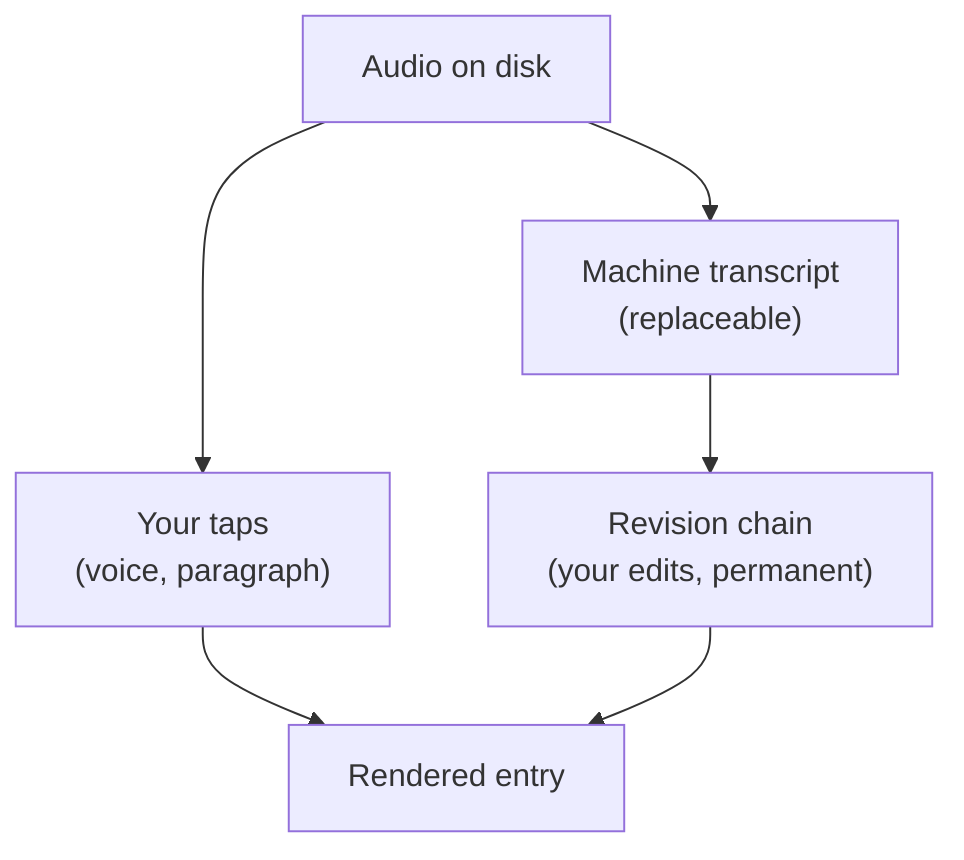
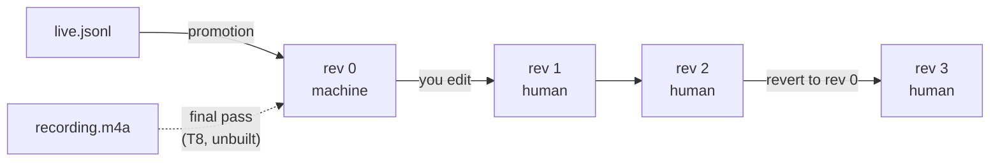

# Raconte: how it works

The system as it stands. Reasons and history are in the linked design docs.
Updated 2026-11-26, at build 32.

## The one idea

**The audio file is the truth. Transcript, dates, voices and paragraphs are
interpretations of it, and each can be redone without losing anything a human
did.**



- Lower layers never depend on upper ones.
- Machine output is replaceable. Human input is never overwritten by a machine.

## 1. Capture

Raw audio is appended to disk in chunks of about 20 seconds. Killing the app
loses at most the last unflushed buffer (0.2 s or less). On stop, the chunks are
encoded to one `recording.m4a`; they are deleted only after the m4a is verified
playable.

Every launch runs a recovery scan that finishes whatever was interrupted.
Nothing is auto-deleted: a recovered recording shows a banner with Keep as the
default.

**The master clock is the frame count.** Marker taps, transcript timestamps and
playback position all use it.

Details: [M1 capture design](plans/2026-07-29-m1-capture-design.md)

## 2. An entry

An entry is a capture directory. The files are the archive; there is no second
source of truth.

```
captures/<id>/                     # id is a ULID, sorts by creation time
  manifest.json                    # machine state: format, phase, transcript ref
  entry.json                       # your state: journal, date, trash, voices
  final/recording.m4a              # the audio
  segments/…                       # raw chunks, until encoding finishes
  images/<id>.<ext>, <id>.json     # photos: original bytes and a sidecar
  transcript/
    live.jsonl                     # what the machine heard, as it heard it
    markers.jsonl                  # your taps, raw
    canonical-0.json, -1.json …    # the revision chain (§5)
    head.json                      # cache of "what's current", disposable
    draft.json                     # an edit in progress
```

- `entry.json` is a separate file so a metadata edit cannot disturb the
  recording. A missing sidecar means all defaults.
- **The library is a scan of these folders.** The only database is the search
  index (§9), which is rebuilt from the files.
- **Trash** is a 30-day soft delete: a tombstone in the sidecar, restorable,
  then swept. Permanent deletion first renames the directory into a staging
  area, so a half-finished delete cannot resurrect an entry.
- **Quarantine** handles a sidecar that exists but cannot be parsed. Trash lists
  the entry under "Unreadable entries" with one action, which renames the
  directory to `quarantine/<ULID>-<id>/`. Nothing is destroyed. On a syncing
  device a later pull re-creates the entry from the server's healthy copy.

Details: [M3 dogfood plan](plans/2026-08-02-m3-dogfood-mvp-plan.md),
[staged removal](plans/archive/2026-08-05-staged-removal-build-prompts.md)

## 3. Dates

Every entry has two dates:

- **capturedAt**: when it was recorded. Automatic, never edited.
- **originalDate**: the date on the paper page. Optional, editable, and may be
  only a year ("1998") or a month ("1998-03"). It is stored as that string, so
  timezone math cannot shift it. The library browses by this date.

Capture follows the last-viewed journal, and the backdate toggle starts from
that journal's history. A backdate is sticky: it can be changed, never cleared
by one tap.

Ruled, partly unbuilt: what you typed wins, then a date spoken at the start of
the recording, then carry-over from the previous entry. The app does not yet
record how a date arose, so a carried date blocks spoken detection for the rest
of a sitting.

Details: [backdate precedence](plans/2026-08-03-backdate-precedence-ux.md),
[backdate seed](plans/2026-09-25-backdate-seed-plan.md)

## 4. Markers

The paper journals are two-voice conversations. No machine can tell the voices
apart, so you mark them live: a switch-voice button and an end-paragraph button,
each confirmed by a haptic.

- **A tap is stored as the raw audio frame where it happened and is never
  modified.** On read, taps snap to the nearest silence between words
  (±0.75 s). A better snapping rule later re-derives from the same raw taps.
- With no gap to snap to, the boundary is kept and flagged approximate.
- Voices are a per-journal "Two voices" toggle. Paragraph marking works either
  way.
- The entry is cut into paragraphs at every paragraph tap and voice switch. By
  default there are no labels: the main voice is italic, the other regular.
  Labels are opt-in per journal.

Details: [markers design](plans/2026-08-05-capture-structure-markers-design.md)

## 5. The transcript

The model is a small git for one entry's text.

- A **revision** is a complete, immutable snapshot (`canonical-N.json`). A
  higher number does not mean newer.
- Every revision names its parent. Revisions are **machine** (the transcriber
  produced it) or **human** (you edited, or reverted).
- **"Current" is computed, never stored**: the newest revision on the human side
  of the chain. `head.json` caches the answer.
- If any revision file is unreadable, the entry becomes read-only.



**Promotion** folds the live log into revision 0, at finalize, at launch and
when an entry is opened.

**Editing.** A full-screen plain-text editor with Done only. Typing goes to
`draft.json`. When the session ends (Done, 90 s idle, a 60 min cap, or crash
recovery) the draft is diffed against the text it started from and a human
revision is minted. An unchanged draft mints nothing. Voice attribution survives
an edit.

**Audio anchors.** Each span of text remembers the audio frames it came from,
with a grade:

- **exact**: the machine measured these frames for this text.
- **inherited**: edited text, with frames borrowed from the words it replaced.
- **none**: typed from nothing.

An edit can only lower the grade. One ruled exception: retyping a whole word
("Ellen" to "LN") keeps that word's own frames.

**Mark voices.** A separate mode: tap a paragraph to flip its voice, or drag
across words to mark a range. Every action appends to `markers.jsonl`, and a
later append at the same spot wins. Raw taps are never touched. Two things have
no UI yet: retracting a stray tap, and adding a bare paragraph break (#59, #60).

**History and revert.** One screen lists the whole chain and can revert to any
machine revision. A revert mints a new revision; nothing is destroyed. This is
the editor's undo.

**Metadata log.** Journal moves, backdates and trash or restore are appended to
`entry-log.jsonl`. It is written and exported, with no UI yet.

**T8, ruled and not built.** The canonical transcript will come from a pass over
`recording.m4a` after capture, not from the live log. Editing stays locked until
that pass lands. If it fails, `live.jsonl` is promoted as a provisional revision
0 and replaced on a later retry. Two questions are open: how a long pass
survives in the background, and what happens to entries that already carry
edits.

Details: [T6 design](plans/2026-08-03-t6-revision-chain-design.md) (§15 to §17
are the as-built rulings)

## 6. Journals

A journal is a name, an optional cover, optional voice labels and an optional
**span**: the date range the paper journal covers, set by you. With no span, the
date line falls back to what the entries imply.

- The capture picker only selects a journal or starts a new one.
- A journal's place shows its header above its entries. Tapping the header opens
  the journal editor: name, cover, span, voice labels.
- An entry dated outside its journal's span carries a flag on its row and above
  its transcript. It is a flag, never a block.

Details: [journal editing design](plans/2026-08-18-journal-editing-ia-design.md)

## 7. Images

An entry can carry photos, from the camera, the photo library, a file or a drop.
The original bytes are stored as they arrived, with a sidecar (size, sha256,
dimensions) and a generated thumbnail. A photo can be rotated and cropped; a new
one starts on a rectangle 10% inside its edges. Images sync and export with the
entry.

An entry that began as a photo has no way to gain a transcript afterwards
(#107).

Details: [crop and rotate](plans/2026-10-07-image-crop-rotate-design.md),
[crop inset](plans/2026-11-18-crop-inset-pinch-design.md)

## 8. Navigation

One `NavigationSplitView` on both platforms. The sidebar lists **places**: Home,
Capture, one row per journal, All Entries, Trash, Search, About, and Debug in
debug builds.

- The app opens on Home, a bookshelf of journals with one New entry button.
- On iPhone the split view collapses to a stack; on Mac and iPad both columns
  show.
- While a recording runs, the Capture row shows a red dot and the elapsed time.
  The capture coordinator lives at the app root, so leaving the screen does not
  risk the recording.
- An entry list pushes to an entry, which pushes to the editor, Mark voices or
  history. Selecting a sidebar place clears that path, so any screen holding
  edits commits them on the way out.
- Entry detail names its journal, as a link to that journal's place.

Details: [navigation design](plans/2026-08-17-navigation-redesign-design.md),
[home bookshelf](plans/2026-08-29-home-bookshelf-design.md),
[capture screen](plans/2026-08-30-118-capture-screen-design.md)

## 9. Search

Full-text search over transcripts, in its own place in the sidebar.

- The index is SQLite FTS5 through GRDB, at `search/index.sqlite`. It holds only
  the capture id and the text, and is a disposable copy: deleting it costs a
  rebuild.
- Search runs as you type. Every term is prefix-matched, all terms must match, a
  quoted phrase is honoured, and diacritics are folded.
- Results are in date order, newest first, one highlighted snippet per entry.
  Trash is excluded.
- Two filter chips: journal (defaults to the last-viewed journal) and date
  range.
- Opening a result scrolls the entry to the match, highlights every match, and
  offers previous and next.

Details: [search design](plans/2026-10-08-search-design.md)

## 10. Sync

**Each device tells iCloud what it wrote. Immutable things upload once. The
chain means edits never conflict.** Every device holds the whole archive, audio
included.

- **What syncs is what a human made or said**: the recording, the revision
  chain, metadata, marker taps, images. Caches stay on the device.
- **Immutable things cannot conflict.** Two offline edits become two revisions
  off one parent. Both survive, and "current" is computed the same way
  everywhere.
- **Mutable metadata is last-writer-wins, one field at a time.**
- **Entries arrive whole or not at all.** A partial arrival is held privately
  until complete.
- **Land or park, never drop.** iCloud hands a device each record once. An
  arrival the app cannot use yet is written to `sync/parked.json` with its
  reason, and re-fetched at every launch and every return to the foreground. An
  empty parked file is the healthy state.
- **Trash is a synced flag.** Only a permanent deletion removes the record from
  iCloud, and that is final.
- **Sync state is readable in About**: account, last push and pull, pending
  changes, the last error and the parked list.

Details: [M4 sync design](plans/2026-08-17-m4-sync-design.md) (§10 lists the
as-built deviations)

## 11. Export

**iCloud is transport. The export package is longevity.** About → Archive →
**Export archive…** writes one directory per entry: audio, sidecar, markers,
images, every revision, and a rendered `transcript.md`. **Verify archive…** reads a
package back.

- Everything is a byte-for-byte copy except `transcript.md` and the manifest. An
  unreadable sidecar is copied as it is, with a warning.
- Every file carries a sha256, and the manifest `raconte-export.json` is written
  last, so its presence means the copy finished. The package is staged under a
  `.part` name and renamed at the end.
- The verifier checks the package against itself, never against the app, and
  never writes to it.

Details: [export package format](export-format.md)

## Where the project is

Built and in daily use on iPhone and Mac: capture, live on-device
transcription, journals, backdates, library, trash, markers and voice rendering,
the revision chain and its editor, Mark voices, history and revert, the sidebar
of places and Home, iCloud sync, quarantine, export and verify, photos with crop
and rotate, and search.

The current build is **32** (Mac). TestFlight is at 30.
[builds.md](builds.md) lists what each build carries; About → App → Build reads
the number back.

Next, in order:

1. **#210**: on the Mac, Capture Image opens the file chooser directly.
2. **#195**: the camera stays open for several photos.
3. **#107**: add text to an entry that began as a photo. It needs a design
   ruling first.
4. **T8**, the final pass (§5), with #44, #51 and #2. Spec, then plan, then
   build. Biasing so "LN" stops transcribing as "ellen" (#38) goes with it.
5. **Design sweep**: #170 type hierarchy with #173, then #55 and #86.
6. **The unified editor** (#60, #59): one editor showing paragraph and voice
   structure, replacing Mark voices. It comes after T8.
7. **Migration**: bring in the 36 entries from the old web app, then take it
   down ([data model and migration](plans/2026-07-29-data-model-and-migration.md)).
8. **#208**: Edit transcript and Mark voices need work; not yet diagnosed.

Owner-only, at any time: the M4 acceptance gate (#187), which has never been
run. Move the app container aside, relaunch, let sync settle, then export,
verify and compare counts with the phone.

Smaller work is in the GitHub issues.

## Reading the docs

- **This file** is the current model. Where it disagrees with an older design
  section, this file is newer.
- [plans/README.md](plans/README.md) sorts the design docs into living specs,
  approved designs and an archive of executed build plans.
- The design docs are decision records. They keep their history, superseded
  sections included.
- [user-journeys.md](user-journeys.md) is the intent document: nine
  walk-throughs written before the app was built.
- [devlog.md](devlog.md) is the session-by-session history.
